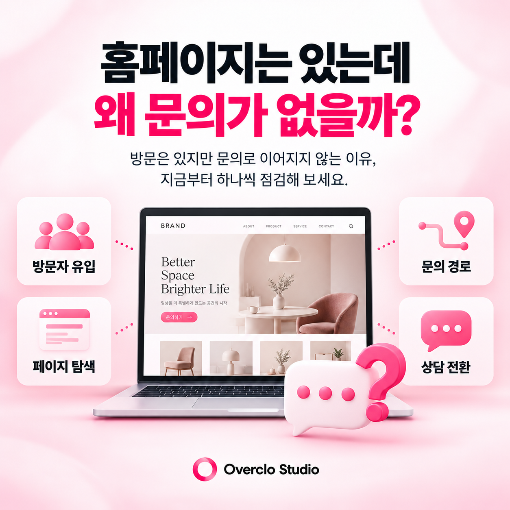
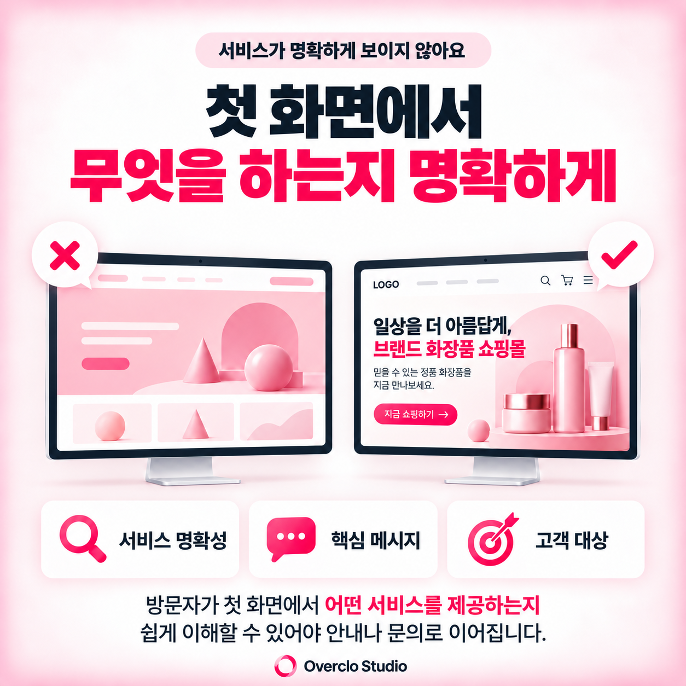
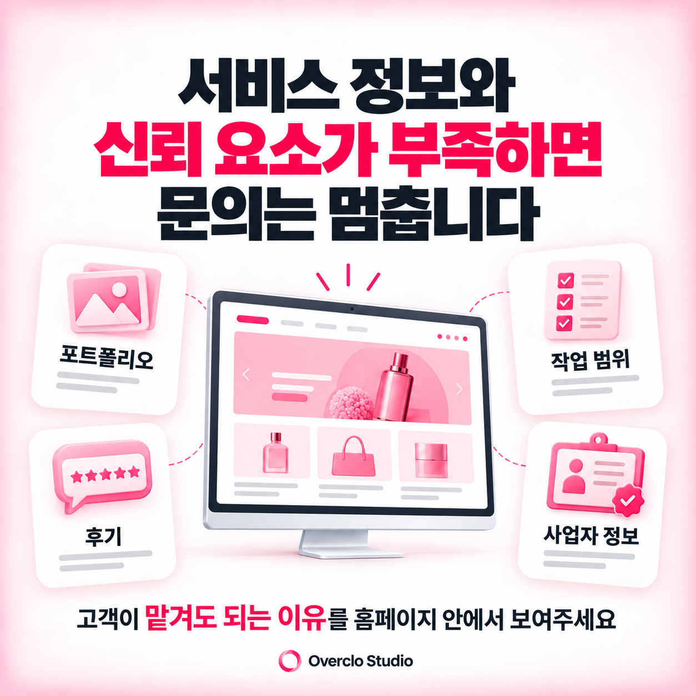
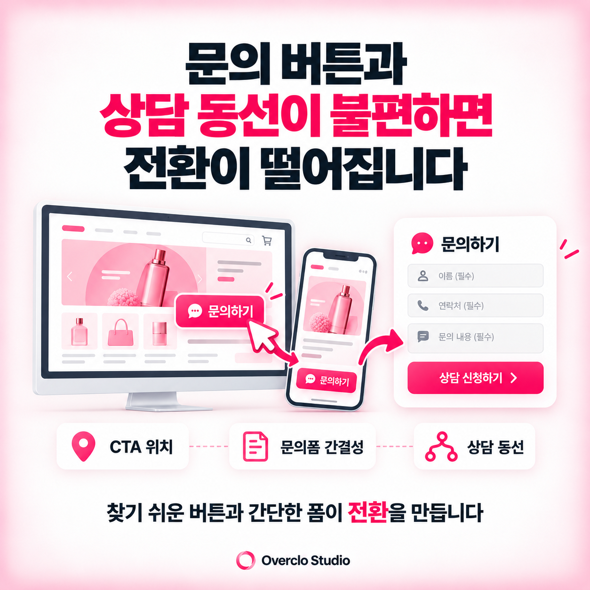
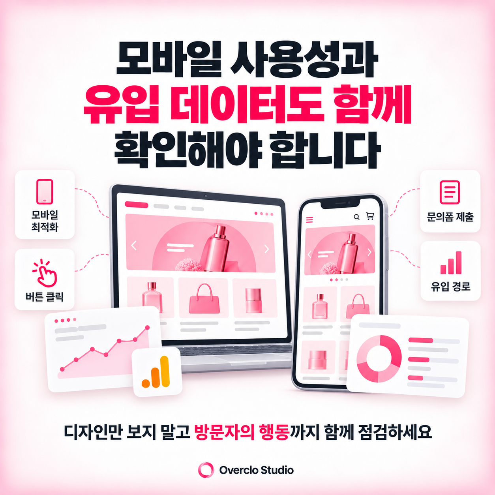

# 홈페이지를 만들었는데 문의가 없는 이유 5가지

**카테고리:** 홈페이지 제작  
**한 줄 설명:** 홈페이지 방문자는 있지만 상담이나 문의로 이어지지 않는 이유를 첫 화면 메시지, 서비스 정보, 신뢰 요소, CTA 버튼, 모바일 사용성 관점에서 정리합니다.

## 요약

홈페이지를 만들었는데 문의가 없다면 디자인뿐 아니라 방문자가 정보를 확인하고 행동하는 과정에 문제가 없는지 살펴봐야 합니다. 홈페이지 문의 전환에는 첫 화면 메시지, 서비스 설명, 신뢰할 수 있는 정보, 문의 버튼의 위치와 모바일 사용성이 영향을 줍니다. 다만 실제 방문자 수가 적거나 유입 고객이 서비스와 맞지 않는 경우도 있으므로 유입 데이터와 홈페이지 구조를 함께 확인하는 것이 중요합니다.

## 핵심 체크리스트

- 첫 화면에서 어떤 서비스를 제공하는지 명확하게 보여줘야 합니다.
- 방문자가 궁금해할 서비스 내용과 이용 조건을 쉽게 찾을 수 있어야 합니다.
- 실제 작업 사례와 고객 후기 등 신뢰할 수 있는 근거가 필요합니다.
- 문의 버튼은 찾기 쉬워야 하며 모바일에서도 사용하기 편해야 합니다.

## 첫 화면에서 무엇을 하는 업체인지 알기 어렵습니다

홈페이지에 방문한 고객은 필요한 정보를 빠르게 확인하려고 합니다. 하지만 첫 화면에 추상적인 브랜드 문구나 이미지 중심의 디자인만 있다면 어떤 서비스를 제공하는 업체인지 이해하기 어려울 수 있습니다.

예를 들어 홈페이지 제작 업체라면 회사소개보다 홈페이지 제작, 쇼핑몰 제작, 유지보수처럼 실제 제공하는 서비스가 명확하게 드러나는 것이 좋습니다.

첫 화면에서는 누구에게 어떤 서비스를 제공하는지, 고객이 어떤 도움을 받을 수 있는지 전달해야 합니다. 고객이 필요한 정보를 찾지 못하면 다른 홈페이지로 이동할 가능성이 있습니다.

특히 검색광고나 외부 콘텐츠를 통해 방문했다면 검색할 때 기대했던 서비스와 홈페이지 첫 화면의 내용이 일치하는지도 확인해야 합니다.

## 서비스 정보와 문의 조건이 부족합니다

홈페이지에 서비스 이름만 나열되어 있다면 고객이 실제 의뢰 가능 여부를 판단하기 어렵습니다.

고객은 어떤 작업을 맡길 수 있는지, 제작 과정은 어떻게 진행되는지, 어느 정도의 자료를 준비해야 하는지 궁금해합니다.

홈페이지 제작 서비스를 예로 들면 제작 방식, 진행 절차, 예상 일정에 영향을 주는 요소, 제공 범위 등을 안내하는 것이 좋습니다.

비용을 모두 공개하기 어렵더라도 견적이 달라지는 기준이나 상담 전 준비사항을 설명하면 고객이 문의 여부를 판단하는 데 도움이 됩니다.

서비스 설명은 단순히 길게 작성하기보다 고객이 실제로 궁금해할 내용을 중심으로 구성하는 것이 중요합니다.

## 고객이 신뢰할 수 있는 근거가 부족합니다

방문자는 홈페이지에서 서비스를 확인한 뒤 실제로 맡겨도 괜찮을지 판단합니다. 이 과정에서 중요한 요소가 포트폴리오와 신뢰 정보입니다.

디자인 제작 업체라면 완성된 이미지뿐 아니라 어떤 목적의 프로젝트였는지, 어떤 기능과 구성을 적용했는지 설명하는 것이 좋습니다.

고객 후기, 운영 중인 실제 홈페이지, 작업 범위, 사업자 정보처럼 확인할 수 있는 자료도 신뢰 형성에 도움이 됩니다.

다만 실제로 확인되지 않은 성과 수치나 과장된 후기를 활용하는 것은 피해야 합니다. 신뢰를 높이는 데 필요한 것은 많은 수식어보다 검증할 수 있는 정보입니다.

오버클로 스튜디오처럼 다양한 홈페이지와 디자인 프로젝트를 진행하는 업체라면 포트폴리오별 제작 목적과 설계 방향을 구체적으로 보여주는 방식이 효과적입니다.

## 문의 버튼과 상담 동선이 불편합니다

홈페이지에 충분한 정보가 있어도 문의 방법을 찾기 어렵다면 고객의 행동이 끊길 수 있습니다.

문의 버튼이 페이지 맨 아래에만 있거나 상담 페이지까지 여러 번 이동해야 한다면 사용성이 떨어집니다.

서비스 소개 이후, 포트폴리오 확인 이후, 페이지 하단처럼 고객이 문의를 고려할 만한 위치에 버튼을 배치하는 것이 좋습니다.

문의폼을 사용할 때는 입력 항목도 확인해야 합니다. 처음 문의하는 고객에게 지나치게 많은 정보를 요구하면 작성 부담이 커질 수 있습니다.

문의 목적에 필요한 최소한의 정보를 받고, 상세한 내용은 후속 상담에서 확인하는 방식도 고려할 수 있습니다.

## 모바일 화면에서 이용하기 어렵습니다

반응형 홈페이지로 제작했더라도 모바일 사용성이 충분히 확보되었다고 단정할 수는 없습니다.

PC에서는 보기 좋은 화면이 모바일에서는 글자가 작게 보이거나 버튼을 누르기 어려울 수 있습니다. 이미지가 잘리거나 메뉴가 복잡하게 표시되는 문제도 발생할 수 있습니다.

모바일에서는 첫 화면의 메시지, 메뉴 이동, 버튼 크기, 문의폼 입력과 제출 과정까지 확인해야 합니다.

특히 문의 버튼을 눌렀을 때 연결이 정상적으로 작동하는지, 상담 신청 후 완료 안내가 표시되는지까지 점검하는 것이 좋습니다.

홈페이지 개선의 목적은 단순히 디자인을 바꾸는 것이 아닙니다. 방문자가 필요한 정보를 확인하고 문의까지 이어갈 수 있는 환경을 만드는 것입니다.

## 홈페이지 리뉴얼 전에 유입 데이터도 함께 확인해야 합니다

홈페이지 문의가 적다고 해서 반드시 디자인에 문제가 있는 것은 아닙니다.

검색 노출이 부족해 방문자가 거의 없거나, 광고를 통해 방문한 고객의 관심사와 서비스가 맞지 않을 수도 있습니다. 따라서 홈페이지 리뉴얼을 결정하기 전에 방문자 수, 유입 경로, 주요 페이지 이동, 문의 버튼 클릭, 폼 제출 완료 여부를 확인하는 것이 좋습니다.

Google Analytics 4(GA4)는 사이트 유입과 페이지 조회를 분석할 수 있으며, 환경에 따라 `form_start`(양식 작성 시작), `form_submit`(양식 제출) 이벤트를 수집할 수 있습니다. 실제 잠재고객 문의 완료는 `generate_lead` 같은 추천 이벤트로 구분해 측정할 수 있습니다. 문의 버튼 클릭과 실제 제출 완료를 혼동하지 않아야 하며, 각 이벤트가 정상적으로 수집되는지 확인해야 합니다.

오버클로 스튜디오는 홈페이지를 브랜드 소개 공간이면서 고객 행동으로 이어지는 접점으로 바라봅니다. 홈페이지 문의가 적다면 디자인 변경부터 시작하기보다 정보 전달, 신뢰 형성, 상담 동선과 유입 상태를 함께 점검하는 것이 좋습니다.

## 자주 묻는 질문

### 홈페이지 방문자가 있는데 문의가 없는 이유는 무엇인가요?
방문자의 관심사와 서비스가 맞지 않거나, 홈페이지에서 필요한 정보를 찾기 어렵거나, 문의 과정이 불편할 수 있습니다. 유입 경로와 홈페이지 내 행동 데이터를 함께 살펴봐야 원인을 구분할 수 있습니다.

### 홈페이지 문의 버튼은 어디에 배치해야 하나요?
첫 화면과 서비스 설명 이후, 신뢰 요소를 확인한 뒤 등 고객이 문의를 고려할 수 있는 위치에 배치하는 것이 좋습니다. 단순히 버튼을 많이 넣기보다 적절한 위치와 문구를 선택하는 것이 중요합니다.

### 홈페이지 디자인을 바꾸면 문의가 늘어날까요?
디자인 변경만으로 문의 증가를 보장할 수는 없습니다. 방문자 유입, 서비스 정보, 신뢰 요소, 상담 동선에 문제가 있다면 해당 부분을 함께 개선해야 합니다.

### 홈페이지 리뉴얼 전에 확인할 데이터는 무엇인가요?
방문자 수, 유입 경로, 주요 페이지 방문, CTA 클릭, 문의폼 제출 여부 등을 확인하는 것이 좋습니다. 이를 통해 유입 부족인지 홈페이지 사용성 문제인지 구분하는 데 도움을 받을 수 있습니다.

## 관련 글

- 홈페이지 제작 비용이 업체마다 다른 이유
- 랜딩페이지와 홈페이지의 차이
- 대전 홈페이지 제작 업체를 고를 때 확인할 기준
- 광고 집행 전 랜딩페이지 제작 체크리스트
