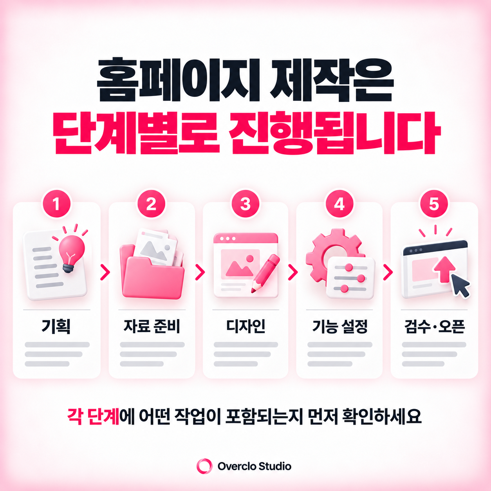

# 홈페이지 제작 기간은 얼마나 걸릴까? 제작 단계별 일정 정리

**카테고리:** 홈페이지 제작  
**한 줄 설명:** 홈페이지 제작 기간을 결정하는 기획, 자료 준비, 디자인, 기능 구현, 검수 과정을 살펴보고 일정이 지연되는 이유와 제작 기간을 줄이는 방법을 정리합니다.

## 요약

홈페이지 제작 기간은 일률적인 평균값보다 작업 범위로 산정해야 합니다. 상담·기획, 자료 준비, 디자인, 기능 설정, 모바일 검수와 오픈 전 점검의 각 단계에서 필요한 일정을 합산합니다. 페이지 수와 제작 방식, 필요한 기능, 콘텐츠 준비 상태에 따라 전체 기간이 달라집니다. 템플릿을 활용한 간단한 홈페이지와 브랜드 기획부터 진행하는 맞춤형 홈페이지는 작업 과정이 다릅니다. 정확한 일정을 산정하려면 기획, 디자인, 기능 설정, 모바일 최적화, 검수와 수정에 필요한 시간을 각각 확인해야 합니다.

## 핵심 체크리스트

- 홈페이지 제작 기간은 페이지 수뿐 아니라 디자인과 기능의 난이도에 따라 달라집니다.
- 로고, 이미지, 소개문 등 자료가 준비되어 있으면 불필요한 일정 지연을 줄일 수 있습니다.
- 디자인 시안 검토와 수정에 필요한 시간도 전체 일정에 포함해야 합니다.
- 도메인 연결, 결제 설정, 모바일 검수 등 오픈 전 확인할 항목을 미리 정리해야 합니다.

## 홈페이지 제작 기간은 어떤 과정으로 결정될까요?

홈페이지 제작을 의뢰할 때 가장 많이 궁금해하는 것 중 하나가 제작 기간입니다.

하지만 홈페이지 제작에 필요한 시간은 모든 프로젝트에 동일하게 적용되지 않습니다. 간단한 회사소개 홈페이지인지, 브랜드 소개와 쇼핑 기능을 함께 구성하는 홈페이지인지에 따라 진행 과정이 달라집니다.

기본적인 홈페이지 제작 과정은 상담 및 요구사항 확인, 기획, 디자인, 기능 설정, 모바일 최적화, 검수, 오픈 순서로 진행됩니다.

프로젝트에 따라 이 단계가 일부 생략되거나 동시에 진행될 수도 있습니다. 견적 상담 단계에서 단계별 작업 항목, 담당자 검토 일정, 수정 및 검수 기간을 포함한 예상 시작·완료일을 확인하는 것이 좋습니다. 오버클로의 실제 프로젝트별 소요기간 자료가 확인되지 않았으므로 평균 며칠 또는 몇 주라는 수치를 임의로 제시하지 않습니다.

## 기획과 자료 준비가 제작 일정에 영향을 줍니다

홈페이지 제작의 첫 단계는 목적과 구성 범위를 정하는 일입니다.

회사소개용 홈페이지인지, 서비스 문의를 받는 홈페이지인지, 상품 판매를 위한 쇼핑몰인지에 따라 메뉴 구성과 필요한 기능이 달라집니다.

이 과정에서 페이지 수, 콘텐츠 구성, 서비스 소개 방식, 문의 기능과 고객 동선을 정리합니다.

또한 로고, 회사소개서, 제품 이미지, 서비스 설명, 포트폴리오 등 필요한 자료를 확인합니다.

디자인 작업이 시작된 이후에 서비스 내용이나 메뉴 구조가 크게 달라지면 이미 진행한 작업을 수정해야 할 수 있습니다.

따라서 제작 초기 단계에서 목표와 자료를 명확하게 정리하는 것이 일정 관리에 도움이 됩니다.

## 디자인과 기능 구현 과정에서 작업량이 달라집니다

홈페이지 디자인은 단순히 색상과 이미지를 배치하는 작업만을 의미하지 않습니다.

메인페이지에서 어떤 메시지를 보여줄지, 서비스 정보를 어떤 순서로 배치할지, 고객이 어디에서 문의나 구매를 진행할지 설계해야 합니다.

기존 템플릿을 활용하면 일부 디자인 작업을 줄일 수 있지만, 브랜드에 맞춰 레이아웃과 콘텐츠를 새롭게 구성하는 경우에는 추가 시간이 필요합니다.

기능 구현 과정에서도 차이가 발생합니다. 문의폼, 예약, 상품 등록, 회원가입, 결제 기능처럼 작업과 테스트가 필요한 항목이 많을수록 일정이 달라집니다.

아임웹이나 카페24처럼 기존 플랫폼을 사용하더라도 필요한 기능이 지원되는지 확인하고, 실제 운영 방식에 맞게 설정하는 과정이 필요합니다.

홈페이지 제작 기간을 산정할 때는 디자인 작업과 기능 설정을 구분해 확인하는 것이 좋습니다.

## 수정과 검수 기간도 전체 일정에 포함해야 합니다

홈페이지의 기본 화면이 완성되었다고 해서 바로 오픈할 수 있는 것은 아닙니다.

PC와 모바일 환경에서 디자인이 정상적으로 보이는지, 버튼과 메뉴가 올바르게 작동하는지 확인해야 합니다.

특히 문의폼이 정상적으로 제출되는지, 알림이 전달되는지, 결제나 예약 기능이 실제로 작동하는지 테스트하는 과정이 중요합니다.

디자인 시안 검토와 수정도 일정에 영향을 줍니다. 처음 정한 작업 범위 안에서 문구와 이미지를 수정하는 경우와 메뉴 구조나 기능 자체를 변경하는 경우에는 필요한 작업량이 다릅니다.

제작 과정에서 수정 범위와 피드백 일정을 미리 정하면 불필요한 지연을 줄이는 데 도움이 됩니다.

## 홈페이지 제작 기간을 줄이려면 무엇을 준비해야 할까요?

제작 기간을 줄이기 위해서는 무조건 디자인 작업을 빠르게 진행하는 것보다 작업 중 변경사항을 줄이는 것이 중요합니다.

홈페이지 제작 전에는 다음 내용을 먼저 정리하는 것이 좋습니다.

| 준비 항목 | 확인 내용 |
|---|---|
| 제작 목적 | 회사 소개, 문의, 예약, 쇼핑몰 운영 등 |
| 메뉴 구성 | 필요한 페이지와 메뉴 구조 |
| 콘텐츠 자료 | 로고, 사진, 서비스 설명, 회사소개 |
| 참고 사이트 | 원하는 디자인과 기능을 구분해 전달 |
| 필수 기능 | 문의폼, 예약, 회원가입, 결제 등 |
| 담당자 | 시안 확인과 수정 의견을 전달할 담당자 |
| 오픈 준비 | 도메인, 운영 계정, 결제 및 외부 서비스 정보 |

자료가 충분하더라도 수정 요청이 여러 차례 분산되면 제작 일정이 늘어날 수 있습니다. 가능한 한 내부 의견을 정리한 뒤 한 번에 전달하는 것이 효율적입니다.

오픈을 서두르기 위해 기능 검수나 모바일 테스트를 생략하는 것은 권장하기 어렵습니다. 제작 속도와 함께 안정적인 운영 준비까지 고려해야 합니다.

오버클로 스튜디오는 홈페이지 제작 과정에서 브랜드의 목적과 필요한 기능, 디자인 구성, 고객 동선을 함께 고려합니다. 홈페이지 제작을 계획하고 있다면 원하는 오픈 일정과 필수 작업 범위를 먼저 정리하고 상담을 진행하는 것이 좋습니다.

## 자주 묻는 질문

### 홈페이지 제작 기간은 보통 얼마나 걸리나요?
일괄적인 평균 기간을 단정하기는 어렵습니다. 제작 범위를 확정한 뒤 기획·자료 준비·디자인·기능 구현·검수에 필요한 일정과 고객 피드백 기간을 더해 예상 완료일을 산정하는 방식이 정확합니다.

### 아임웹 홈페이지는 더 빠르게 제작할 수 있나요?
아임웹은 제공되는 편집 도구와 기능을 활용할 수 있어 일부 제작 과정을 줄일 수 있습니다. 다만 맞춤형 디자인, 콘텐츠 구성, 추가 기능이나 연동 작업이 필요한 경우에는 제작 기간이 길어질 수 있습니다.

### 홈페이지 제작 도중 내용을 수정할 수 있나요?
수정은 가능할 수 있지만 계약한 수정 범위와 제작 단계에 따라 추가 작업이 발생할 수 있습니다. 특히 메뉴 구조, 기능, 페이지 수 변경은 일정에 영향을 줄 수 있으므로 제작 전에 기준을 정하는 것이 좋습니다.

### 홈페이지 제작 기간을 단축하려면 어떻게 해야 하나요?
회사소개, 로고, 이미지, 서비스 설명 등 기본 자료를 미리 준비하고 원하는 메뉴와 필수 기능을 명확하게 정리하는 것이 좋습니다. 또한 시안 검토 담당자를 정하고 수정 의견을 취합하면 일정 관리에 도움이 됩니다.

### 홈페이지 완성 후 바로 운영할 수 있나요?
디자인과 기능이 완성되더라도 도메인 연결, 모바일 검수, 문의폼 테스트, 결제 설정 등 필요한 확인을 마쳐야 합니다. 홈페이지의 목적과 기능에 따라 오픈 전 검수 항목이 달라집니다.

## 관련 글

- 홈페이지 제작 전 준비해야 할 자료
- 홈페이지 제작 비용이 업체마다 다른 이유
- 대전 소상공인 홈페이지 제작 전 준비해야 할 것
- 대전 홈페이지 제작 업체를 고를 때 확인할 기준

## 정보 검토 기준

- 최종 정보 검토일: 2026-10-19
- 제작 기간은 업체·프로젝트별로 달라지는 실무 변수이며, 오버클로의 확정된 작업 일정표 없이 특정 주·일 수를 단정하지 않습니다.
- 실제 프로젝트 소요기간을 게시하려면 시작일·완료일·중간 승인·변경사항을 내부 기록으로 확인한 후 반영합니다.
